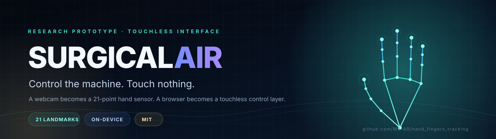
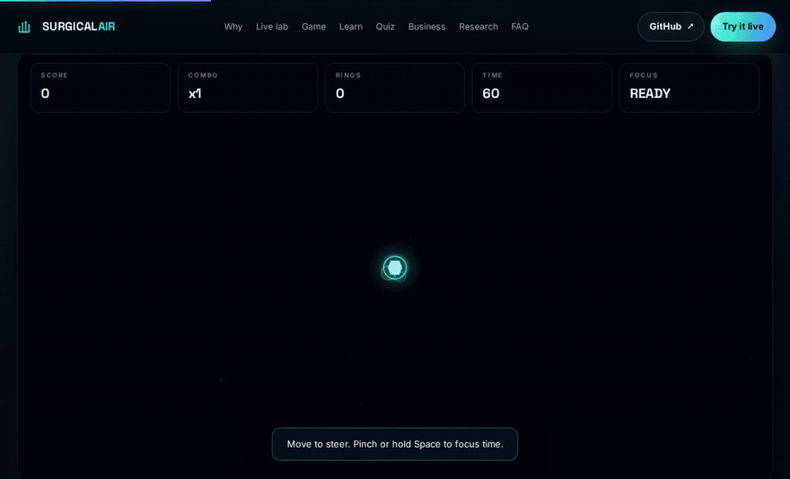
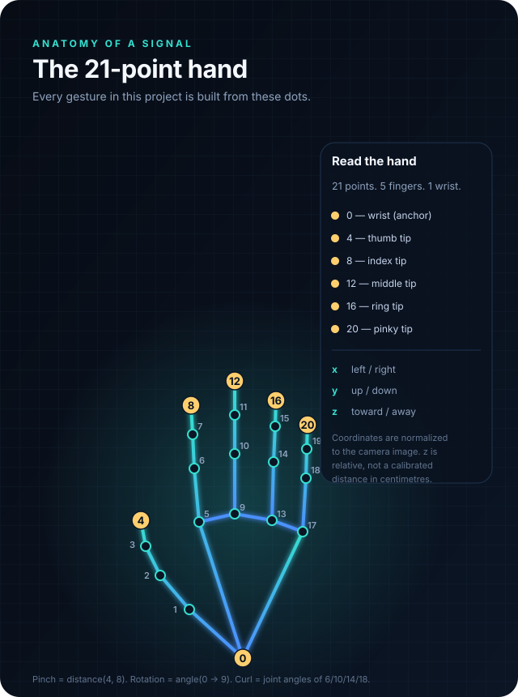
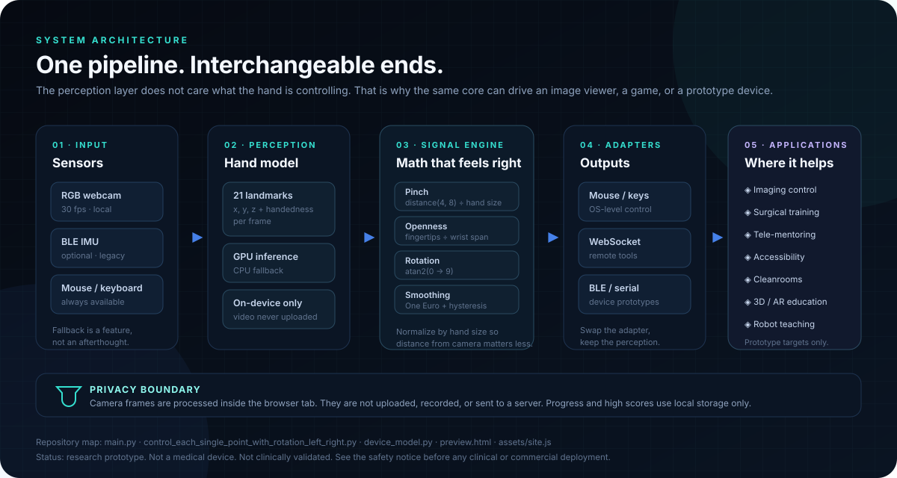
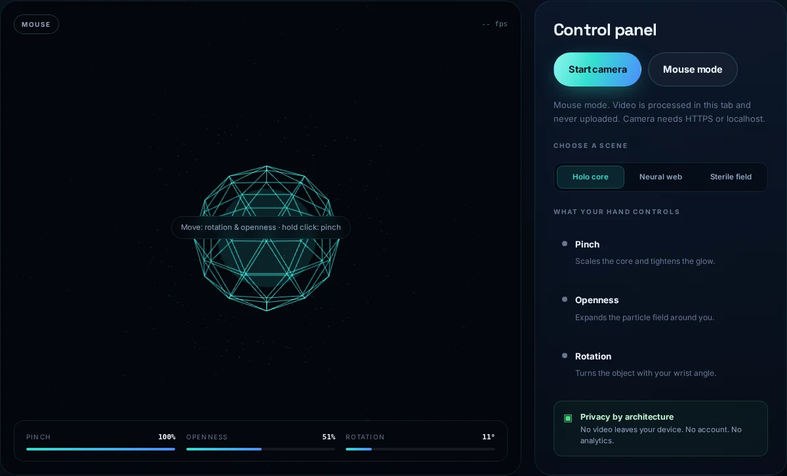
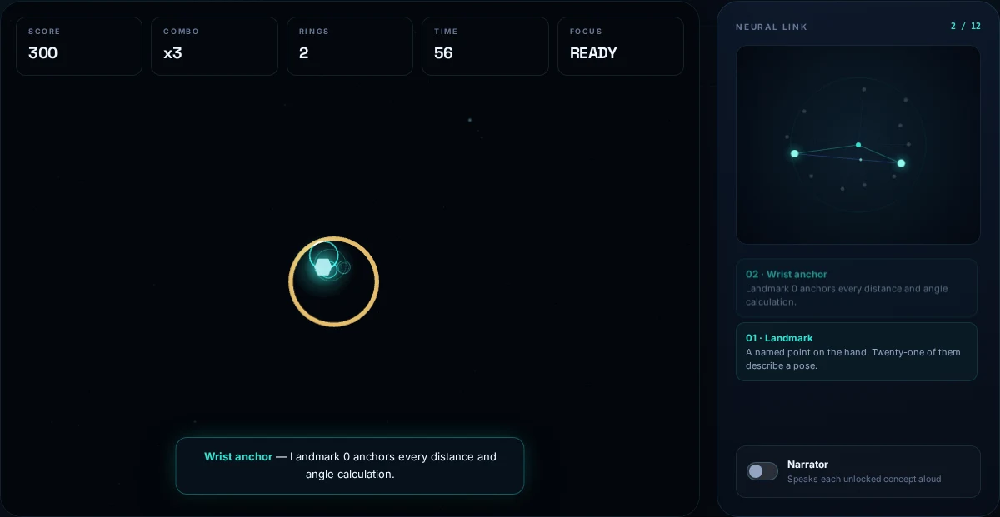
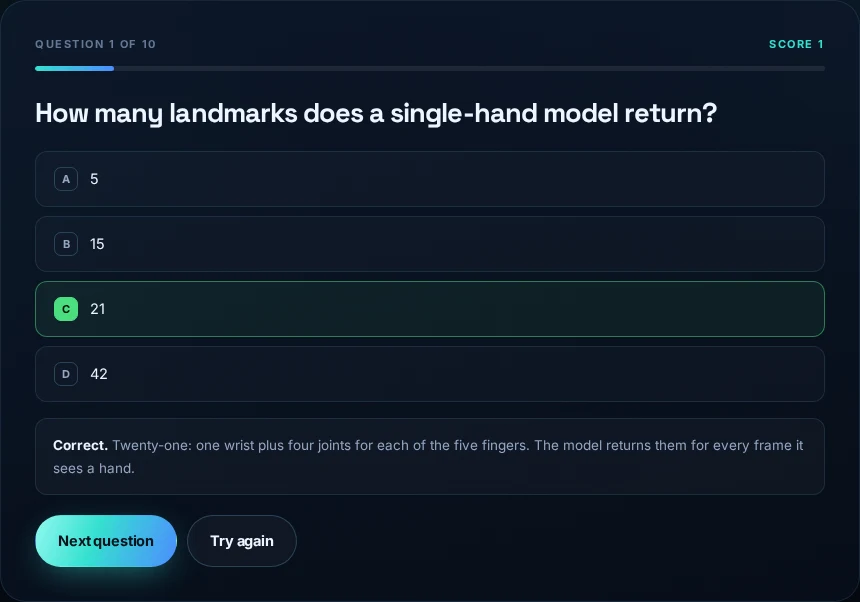
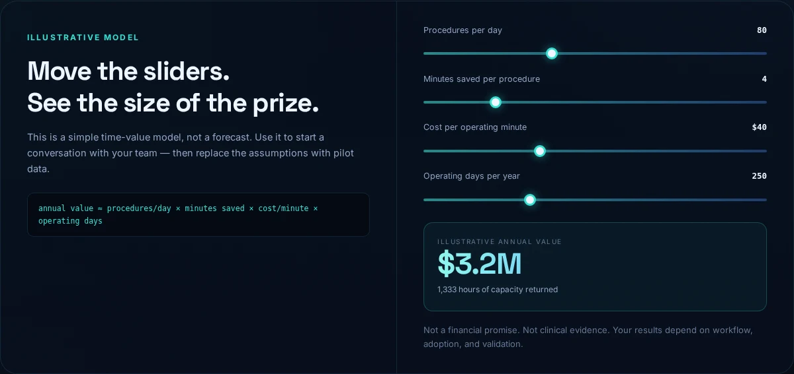
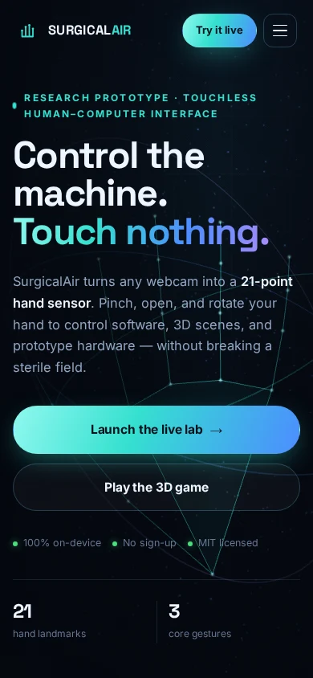

<div align="center">



# SurgicalAir

### Control the machine. Touch nothing.

**A webcam becomes a 21-point hand sensor. A browser becomes a touchless control layer.**

[](https://m0-ar.github.io/hand_fingers_tracking/)
[](LICENSE)
[](requirements.txt)
[](preview.html)
[](#privacy-by-architecture)
[](#safety-and-limitations)

[**Try the live lab**](https://m0-ar.github.io/hand_fingers_tracking/) ·
[**Play the 3D game**](https://m0-ar.github.io/hand_fingers_tracking/preview.html#game) ·
[**Take the quiz**](https://m0-ar.github.io/hand_fingers_tracking/preview.html#quiz) ·
[**Read the beginner guide**](#-beginner-guide--read-this-and-you-are-a-professional)

</div>

---

## Abstract

**SurgicalAir is a touchless human–computer interface that turns an ordinary webcam into a precise, real-time hand sensor.** It reads 21 landmarks on a hand, converts geometry into three stable signals — pinch, openness, and rotation — and uses them to control software, 3D scenes, and prototype hardware without contact.

The project exists because modern work has a quiet contradiction: computers expect touch, while many environments — surgical fields, cleanrooms, laboratories, kitchens, and accessibility contexts — punish it. SurgicalAir closes that gap in software. No new hardware. No new surface to sterilise. No video leaves the device.

It is packaged as a complete, honest starting point for research and product exploration: a zero-install browser laboratory, a 3D precision game that teaches the underlying concepts, a five-level beginner curriculum, a ten-question assessment, an interactive business-value model, and a small Python toolkit for webcam and Bluetooth prototyping.

> **One sentence for a busy decision-maker:** SurgicalAir demonstrates, today, that a normal camera plus open software can deliver usable touchless control — and it lays out exactly what must be proven before anyone calls it a product.

**Live site:** <https://m0-ar.github.io/hand_fingers_tracking/>

---

<div align="center">



<sub>The 3D precision game: steer, focus time, pass rings, and grow the Neural Link. Every ring teaches one concept.</sub>

</div>

---

## Table of contents

- [What is SurgicalAir?](#what-is-surgicalair)
- [Why this matters](#why-this-matters)
- [What you can do](#what-you-can-do)
- [Try it in 60 seconds](#try-it-in-60-seconds)
- [Run the Python demos](#run-the-python-demos)
- [The 21 landmarks](#the-21-landmarks)
- [How it works](#how-it-works)
- [The three signals](#the-three-signals)
- [🌱 Beginner Guide — Read This and You Are a Professional](#-beginner-guide--read-this-and-you-are-a-professional)
- [Screenshots](#screenshots)
- [Project structure](#project-structure)
- [Who this is for](#who-this-is-for)
- [Business value](#business-value)
- [Evidence and honest claims](#evidence-and-honest-claims)
- [Safety and limitations](#safety-and-limitations)
- [Roadmap](#roadmap)
- [FAQ](#faq)
- [Plain-language glossary](#plain-language-glossary)
- [Contributing](#contributing)
- [License](#license)
- [Citation](#citation)
- [Acknowledgements](#acknowledgements)

---

## What is SurgicalAir?

SurgicalAir is a **research prototype** for touchless interaction. It watches your hand through a camera, describes the hand as 21 numbered points, and turns the shape of your hand into numbers a computer can act on.

Think of it as three layers:

1. **Eyes.** A webcam captures frames — still pictures, thirty times a second.
2. **Understanding.** A hand model finds 21 points: the wrist, knuckles, and fingertips.
3. **Action.** Simple maths turns those points into gestures. A pinch becomes a click. An open hand becomes a zoom. A wrist tilt becomes a rotation.

The browser version runs entirely inside the page. The Python version runs on a laptop and can also talk to a small Bluetooth sensor for prototyping. Both are included.

**What it is not:** it is not a medical device, not a certified product, and not a claim that surgery becomes safer because of this code. Those claims require evidence that does not exist yet — and the repository says so plainly. See [Safety and limitations](#safety-and-limitations).

---

## Why this matters

### 1. Every touch is a risk

In a sterile environment, a mouse and keyboard are contamination surfaces. A gloved surgeon cannot click a scan without a decision: change gloves, ask someone else, or accept risk. None of those options is free.

### 2. Every unnecessary movement costs attention

A professional using software should think about the task, not the input device. Natural gestures reuse motor skills people already have. Pinch, open, rotate — no manual required.

### 3. Many environments cannot touch at all

Cleanrooms, industrial kitchens, laboratories, operating rooms, and accessibility contexts share one constraint: the user cannot, or should not, touch the computer. The interface should adapt to the human — not the other way around.

### The insight

> A camera is already there. A hand is already yours. The missing piece is software.

SurgicalAir is a working demonstration of that missing piece, plus a clear map of the distance between a demo and a dependable product.

---

## What you can do

| Experience | What it is | Why it matters |
| --- | --- | --- |
| **3D Live Lab** | A real-time 3D scene controlled by your hand or mouse | Feel the interaction in seconds, not slides |
| **Precision Game** | A 60-second 3D ring-runner with a growing "Neural Link" | Learn the concepts by playing, with optional narration |
| **Five-Level Curriculum** | A plain-language path from landmarks to production | Take anyone from zero to a confident explanation |
| **Ten-Question Quiz** | An honest assessment with explanations | Test understanding, not memorisation |
| **Architecture Explorer** | Click through input → perception → signals → adapters → applications | See how the system is put together |
| **Business Value Model** | Sliders for procedures, minutes saved, cost, and days | Start a pilot conversation with real assumptions |
| **Evidence Table** | Claim-by-claim status: studied, published, or not proven | Separate what is known from what is hoped |
| **Python Toolkit** | Webcam demos, per-landmark control, rotation, and a BLE bridge | Extend the idea beyond the browser |

**No install is required for the browser experience.** A camera is optional: every interactive section works with mouse and keyboard.

---

## Try it in 60 seconds

### Option A — open the live site (recommended)

1. Open <https://m0-ar.github.io/hand_fingers_tracking/>
2. Scroll to **Live Lab**.
3. Click **Start camera** and allow access — **or** click **Mouse mode** if you do not want to use a camera.
4. Move inside the 3D viewport. Hold click to pinch. Try the **Neural web** and **Sterile field** scenes.
5. Scroll to the **Precision Game** and press **Start run**.
6. Finish with the **quiz** and the five-level guide.

> Camera access requires **HTTPS** or **localhost**. The live site is HTTPS. If camera access is blocked, mouse mode gives you the same signals.

### Option B — run it locally

```bash
git clone https://github.com/M0-AR/hand_fingers_tracking.git
cd hand_fingers_tracking

# Any static server works. Python is built in:
python3 -m http.server 8000
```

Then open **<http://localhost:8000/preview.html>**.

Do not open the HTML file with a `file://` URL — browsers restrict camera access and ES modules there.

### What to try first

- **Pinch** (thumb + index) should tighten the glowing core.
- **Openness** (how far your fingers reach) should expand the particle field.
- **Rotation** (tilt your wrist) should turn the object.
- In the game, **pinch or hold Space** to slow time. Pass through the **centre** of a ring.
- Turn on **Narrator** to hear each concept spoken as you unlock it.

---

## Run the Python demos

### Requirements

- Python **3.9–3.12**
- A webcam
- macOS, Windows, or Linux

```bash
python3 -m venv .venv

# macOS / Linux
source .venv/bin/activate

# Windows (PowerShell)
# .venv\Scripts\Activate.ps1

pip install -r requirements.txt
```

### Demo map

| File | What it demonstrates |
| --- | --- |
| `main.py` | Minimal webcam loop: detect a hand, draw 21 landmarks, classify open vs closed |
| `control_each_single_point.py` | Track one landmark at a time and print its position |
| `control_each_single_point_with_rotation.py` | Add wrist rotation and finger joint angles |
| `control_each_single_point_with_rotation_left_right.py` | The fullest demo: distance, rotation, joint angles, left/right handedness |
| `github_example.py` | Save annotated frames to an output folder for documentation |
| `device_model.py` | A small BLE device model used by the sensor bridge |
| `test.py` | Scan for a compatible BLE sensor and stream its data |

Run the main demo:

```bash
python3 main.py
```

Press **q** in the video window to quit.

### Bluetooth sensor bridge (optional)

`test.py` and `device_model.py` talk to a compatible WitMotion-style BLE IMU. The bridge is included for prototyping sensor fusion. It is **not** required for the webcam experience and it is **not** a medical-grade communication layer.

Set your sensor address through an environment variable rather than editing the file:

```bash
BLE_MAC="AA:BB:CC:DD:EE:FF" python3 test.py
```

If no sensor is present, the webcam demos are unaffected. Treat the BLE path as experimental.

---

## The 21 landmarks

<div align="center">

</div>

A **landmark** is simply a named point on the hand. The model returns 21 of them for every frame in which it sees a hand.

- **0** — the wrist. The anchor for distance and angle calculations.
- **4, 8, 12, 16, 20** — the five fingertips, from thumb to pinky.
- **9** — the base of the middle finger. A stable centre point.
- Everything between is a joint: five fingers × four points = 20, plus the wrist = **21**.

Each point has three numbers:

| Coordinate | Meaning | Important caveat |
| --- | --- | --- |
| `x` | Left / right position in the image | Normalised, usually 0–1 |
| `y` | Up / down position in the image | Normalised, usually 0–1 |
| `z` | Estimated depth | **Relative**, not centimetres |

> **The most important sentence on this page:** `z` is not a measurement. It helps order points and add parallax. It is not a ruler.

---

## How it works

<div align="center">

</div>

Every hand-tracking application is the same loop:

```
camera frame → hand model → 21 landmarks → signals → decision → action
      ↑                                                           |
      └────────────────────── repeat 30× per second ──────────────┘
```

### Stage 1 — Input

A standard RGB webcam. No depth camera, no gloves, no markers. Mouse and keyboard remain available as a fallback at all times.

### Stage 2 — Perception

A hand model infers 21 landmarks and a handedness label. In the browser, inference runs inside the tab. In Python, the MediaPipe SDK is used.

### Stage 3 — Signal engine

Raw landmarks are noisy. The signal engine converts geometry into stable, scale-independent numbers: pinch ratio, openness, and rotation. Smoothing and hysteresis make those numbers feel human rather than twitchy.

### Stage 4 — Adapters

Signals become actions: a 3D scene, a mouse event, a WebSocket message, or a BLE command. Adapters are deliberately replaceable. The perception layer does not care what the hand controls.

### Stage 5 — Applications

Imaging review, simulation, training, tele-mentoring, accessibility, cleanroom control, and robot teaching. Each application carries its own validation burden.

### Privacy by architecture

Camera frames are processed in the browser tab. They are **not recorded, uploaded, or sent to a server**. The page has no analytics and no account system. The model files are downloaded from a public CDN, but your video stays on your device. Progress, quiz scores, and game bests use local storage only.

---

## The three signals

### 1. Pinch — "how closed is the gap?"

Measure the distance between the thumb tip (**4**) and the index tip (**8**), then divide by the size of the hand:

```python
import math

def distance(a, b):
    return math.sqrt((a.x - b.x) ** 2 + (a.y - b.y) ** 2)

def pinch_ratio(hand):
    gap = distance(hand.landmark[4], hand.landmark[8])
    size = distance(hand.landmark[0], hand.landmark[9])
    return gap / max(size, 1e-6)
```

- **Small ratio** → fingers are close → pinch.
- **Large ratio** → hand is open.
- **Dividing by hand size** makes the number work for a child or an adult, near or far from the camera.

### 2. Openness — "how far do the fingertips reach?"

Average the distance from the wrist to all five fingertips, again normalised by hand size. A fist gives a small value; a spread hand gives a large value.

### 3. Rotation — "which way is the hand pointing?"

Take the angle from the wrist (**0**) to the base of the middle finger (**9**):

```python
angle = math.degrees(math.atan2(middle.y - wrist.y, middle.x - wrist.x))
```

Use the angle to rotate an object, scrub a timeline, or steer a probe.

### Why hysteresis matters

Raw signals hover. A single threshold flickers. Use **two** thresholds — one to enter a state, a different one to leave it:

```javascript
let pinching = false;

function updatePinch(ratio) {
  if (!pinching && ratio < 0.30) pinching = true;       // enter
  else if (pinching && ratio > 0.45) pinching = false;  // leave
  return pinching;
}
```

The gap between `0.30` and `0.45` is called **hysteresis**. It is the difference between a demo that feels broken and one that feels calm.

### Why smoothing matters

Landmarks jitter by a pixel or two every frame. Exponential smoothing is the simplest fix:

```javascript
const smooth = (previous, next, alpha = 0.72) =>
  previous + (next - previous) * (1 - alpha);
```

For production-quality pointers, the **One Euro filter** adapts its smoothing to speed: stable when the hand is still, responsive when it moves quickly. See the [research links](#acknowledgements).

---

## 🌱 Beginner Guide — Read This and You Are a Professional

This guide assumes **zero** background. No maths degree. No computer-vision course. No medical training. Read the five levels in order and you will understand the whole system.

> "Let's work this out in a step-by-step way to be sure we have the right answer."

By the end, you will be able to explain how a webcam becomes a gesture, why the maths works, what breaks in the real world, and what must happen before a prototype becomes a product. **You will know more than most interview candidates.**

---

### Level 1 — See the dots

**One idea:** a hand can be described by 21 points.

Hold up your hand. Count the places where it bends: the wrist, the knuckles, the joints inside each finger, the fingertips. That is what the model returns — a connect-the-dots drawing that updates thirty times a second.

**What to remember**

- Landmark **0** is the wrist.
- Landmarks **4, 8, 12, 16, 20** are the fingertips.
- Landmark **9** is the middle knuckle — a stable centre.
- `x` and `y` are positions in the image. `z` is relative depth, not distance.

**Checkpoint:** can you name the wrist, the five fingertips, and landmark 9 without looking?

---

### Level 2 — Measure the gap

**One idea:** a gesture is geometry.

A pinch is not a magical event. It is a small distance between two points. The distance between two points is the square root of the squared differences:

```python
def distance(a, b):
    return math.sqrt((a.x - b.x) ** 2 + (a.y - b.y) ** 2)
```

Now divide by the size of the hand — wrist to middle knuckle:

```python
ratio = distance(thumb_tip, index_tip) / distance(wrist, middle_knuckle)
```

Why divide? Imagine a photo of a hand. Move the hand closer to the camera and every distance grows. Divide by another distance in the same photo and the scale cancels out. That is why the ratio works for different people and different distances.

**Checkpoint:** can you explain why the division makes the gesture more robust?

---

### Level 3 — Make it feel human

**One idea:** raw numbers are noisy; interfaces need calm.

Two tools fix almost everything:

1. **Hysteresis** — two thresholds instead of one. A pinch starts below `0.30` and ends above `0.45`. The "maybe" zone no longer flickers.
2. **Smoothing** — blend each new value with the previous one. The cursor stops looking drunk.

```javascript
let pinching = false;

function updatePinch(ratio) {
  if (!pinching && ratio < 0.30) pinching = true;
  else if (pinching && ratio > 0.45) pinching = false;
  return pinching;
}

const smooth = (previous, next, alpha = 0.72) =>
  previous + (next - previous) * (1 - alpha);
```

**Checkpoint:** can you explain hysteresis in one sentence? *(Two thresholds prevent rapid toggling near a boundary.)*

---

### Level 4 — Build the loop

**One idea:** every hand-tracking app is the same five-step loop.

```
read frame → detect hand → compute signals → decide → act
```

Here is the whole loop in Python:

```python
import cv2
import mediapipe as mp

mp_hands = mp.solutions.hands
cap = cv2.VideoCapture(0)

with mp_hands.Hands(min_detection_confidence=0.8,
                    min_tracking_confidence=0.5) as hands:
    while cap.isOpened():
        ok, frame = cap.read()
        if not ok:
            continue

        rgb = cv2.cvtColor(cv2.flip(frame, 1), cv2.COLOR_BGR2RGB)
        result = hands.process(rgb)

        if result.multi_hand_landmarks:
            hand = result.multi_hand_landmarks[0]
            # pinch_ratio(hand) → threshold → action
            print(pinch_ratio(hand))

        cv2.imshow("SurgicalAir", frame)
        if cv2.waitKey(5) & 0xFF == ord("q"):
            break

cap.release()
cv2.destroyAllWindows()
```

The browser version swaps OpenCV for an in-tab model. The shape of the loop never changes.

**Checkpoint:** can you describe the five steps without notes?

---

### Level 5 — Ship it safely

**One idea:** a demo that works on your laptop is not a product.

The gap between "it works" and "you can depend on it" is made of five things:

| Requirement | What it means in practice |
| --- | --- |
| **Fallback** | Mouse, keyboard, or touch must always remain available |
| **Privacy** | Process frames on-device; never upload video by default |
| **Performance** | Cap pixel ratio, lazy-load the model, pause when the tab is hidden |
| **Safety** | If a wrong gesture could hurt someone, require confirmation and a human override |
| **Honesty** | Call it a prototype until a study says otherwise |

The most impressive sentence in a technical interview is not *"it works."* It is:

> *"Here is what it does not do yet, and here is how I would find out."*

**Checkpoint:** can you name the first three tests you would run before calling this production-ready?

---

### The 20-minute professional path

If you want the shortest route to real understanding:

1. **5 min** — open the Live Lab, use mouse mode, watch which signal changes.
2. **5 min** — play one round of the Precision Game with the Narrator on.
3. **5 min** — read Levels 2 and 3 above, then take the quiz.
4. **5 min** — open `main.py` and trace the loop line by line.

That is enough to hold a credible conversation about touchless interfaces — and to spot the difference between a demo and a validated product.

---

## Screenshots

<div align="center">

### Live Lab — hand signals, three 3D scenes, mouse fallback


### Precision Game — learn by playing


### Quiz — every answer teaches something


### Business value — move the sliders, test the assumptions


### Mobile — the full experience, no app store


</div>

---

## Project structure

```text
hand_fingers_tracking/
├── preview.html                     # The full interactive experience (3D, lab, game, quiz, business)
├── index.html                       # Entry point; redirects to preview.html for GitHub Pages
├── .nojekyll                        # Tells GitHub Pages to serve files as-is
│
├── assets/
│   ├── site.css                     # Design system and responsive layout
│   ├── core.js                      # UI, quiz, curriculum, ROI model, Neural Link, narration
│   ├── scene.js                     # Three.js hero, 3D lab, game, camera and MediaPipe integration
│   ├── banner.svg                   # README banner
│   ├── hand-landmarks.svg           # The 21-point anatomy diagram
│   ├── architecture.svg             # Five-stage system architecture
│   ├── favicon.svg                  # Browser icon
│   ├── social-preview.png           # 1280×640 social sharing image
│   ├── demo.gif                     # Animated demonstration
│   └── screenshots/                 # Lab, game, quiz, ROI, and mobile screenshots
│
├── main.py                          # Minimal webcam hand-tracking demo
├── control_each_single_point.py     # Track one landmark
├── control_each_single_point_with_rotation.py
├── control_each_single_point_with_rotation_left_right.py
├── github_example.py                # Save annotated frames to disk
├── device_model.py                  # BLE device model
├── test.py                          # BLE sensor scanner and stream
├── orginal.py                       # Byte-identical early copy of main.py (kept for history)
│
├── requirements.txt                 # Python dependencies
├── README.md                        # This document
├── CONTRIBUTING.md                  # How to contribute
├── CODE_OF_CONDUCT.md               # Community standards
├── SECURITY.md                      # How to report a vulnerability
├── CITATION.cff                     # How to cite the project
└── LICENSE                          # MIT
```

---

## Who this is for

| You are… | Start here | What you get |
| --- | --- | --- |
| **A complete beginner** | [Beginner Guide](#-beginner-guide--read-this-and-you-are-a-professional) | A clear mental model, no jargon |
| **A student or job candidate** | Beginner Guide → Quiz → `main.py` | A portfolio-grade explanation of a real system |
| **A developer** | Live Lab → `assets/scene.js` → Python demos | Working code to extend |
| **A researcher** | [Evidence](#evidence-and-honest-claims) → [Limitations](#safety-and-limitations) | Clear claims, known gaps, citable foundations |
| **A founder or product lead** | [Business value](#business-value) | A pilot-shaped conversation, not hype |
| **A clinician or hospital innovator** | [Safety](#safety-and-limitations) → [Roadmap](#roadmap) | The validation path before any clinical use |
| **An educator** | Precision Game + Curriculum | A ready-made, interactive lesson |
| **An accessibility team** | Live Lab (mouse fallback) | A low-cost exploration of hands-free control |
| **A journalist or reviewer** | Abstract → Screenshots → Evidence | The honest version of the story |

---

## Business value

Touchless interaction is not valuable because it is futuristic. It is valuable when it returns **time**, **safety**, or **access**.

### Where the value comes from

| Value driver | Mechanism | Who feels it |
| --- | --- | --- |
| **Sterile throughput** | Fewer breaks to touch a mouse; fewer glove changes; fewer "can someone click this?" moments | Operating-room leadership, infection prevention |
| **Training velocity** | Trainees control anatomy models and videos without looking away | Simulation centres, medical schools |
| **Tele-mentoring** | A hand can be captured as a 21-point overlay — a low-bandwidth teaching signal | Telemedicine, rural health networks |
| **Hands-busy work** | Cleanrooms, labs, kitchens, and accessibility contexts need control without contact | Industrial operations, accessibility teams |
| **Hardware flexibility** | A camera replaces a dedicated controller in some workflows | Device makers, integrators |

### A simple value model

The site includes an interactive model. The formula is deliberately plain:

```text
annual value ≈ procedures/day × minutes saved × cost/minute × operating days
```

**Illustrative example** — not a promise, not clinical evidence:

- 60 procedures per day
- 4 minutes saved per procedure
- $40 cost per operating minute
- 250 operating days per year

```text
60 × 4 × 40 × 250 = $2,400,000 per year
```

That number is only as good as its assumptions. The purpose of the model is to make the assumptions visible, so a team can replace them with pilot data.

### A sane path to a pilot

| Step | Duration | Question answered |
| --- | --- | --- |
| **Technical evaluation** | 2 weeks | Does it run on our hardware, in our lighting, at acceptable latency? |
| **Workflow study** | 4–6 weeks | Does it save time or reduce errors on one narrow task? |
| **Decision** | 1 meeting | Do the numbers justify integration — or did we save a year? |

**What is de-risked today:** landmark tracking, signal extraction, a usable browser demo, on-device processing, and a reproducible open license.

**What is not de-risked:** clinical accuracy under real operating-room conditions, sterility workflow fit, long-session ergonomics, regulatory classification, multi-user behaviour, and any outcome claim.

> **Buyer's rule:** ask for a measured pilot, not a video. A good prototype earns a pilot; only a pilot earns a product.

---

## Evidence and honest claims

SurgicalAir stands on published work. It does not claim that the work has been done on SurgicalAir itself.

| Claim | Status | Basis |
| --- | --- | --- |
| 21 hand landmarks can be inferred from a single RGB frame | **Externally validated** | MediaPipe Hands (Zhang et al., 2020) |
| Adaptive smoothing improves pointer feel | **Published method** | One Euro Filter (Casiez et al., CHI 2012) |
| Touchless interaction is useful in the operating room | **Studied** | GestureClean (AHRQ); IJHCI 2022 |
| Mouse and keyboard fallbacks prevent lock-out | **Engineering principle** | Standard interaction-design practice |
| This repository improves surgical outcomes | **Not proven** | No clinical study of this code exists |
| This repository is a medical device | **False** | It has no regulatory clearance |
| Sub-millimetre or metric precision | **Not claimed** | RGB depth is estimated, not measured |

### Selected foundations

- **MediaPipe Hands** — real-time hand tracking from a single RGB frame. <https://arxiv.org/abs/2006.10214>
- **The One Euro Filter** — adaptive low-pass filtering for noisy interactive signals. <https://gery.casiez.net/1euro/>
- **GestureClean** — AHRQ-funded research on touchless interaction in the operating room. <https://www.ahrq.gov/sites/default/files/2024-02/wachs1-report.pdf>
- **Touchless OR interfaces** — a study of gesture preferences for operating-room interaction. <https://www.tandfonline.com/doi/full/10.1080/10447318.2022.2041896>

---

## Safety and limitations

> **Safety notice:** SurgicalAir is a research prototype. It is not a medical device. It has not been cleared or certified by any regulator. It must not be used for diagnosis, treatment, or any clinical decision. Do not use this code to control a device that can harm a person.

### Known limitations

- **Lighting** — low light, strong backlight, and shadows degrade tracking.
- **Gloves** — gloves change hand appearance and can reduce landmark confidence.
- **Occlusion** — one hand in front of the other, or fingers hidden from the camera, causes errors.
- **Angle** — extreme wrist angles and hands near the edge of the frame are harder.
- **Depth** — `z` is relative. Do not treat it as a measurement.
- **Latency** — every frame of delay is felt. Performance varies by device.
- **One hand** — the browser demo tracks one hand at a time.
- **No clinical validation** — there is no study of accuracy, safety, or outcomes in a clinical setting.
- **No security certification** — the BLE and browser paths are prototypes, not hardened systems.

### What any deployment would require

1. Formal risk management and a quality-management system.
2. Usability engineering with representative users.
3. Cybersecurity review and privacy compliance.
4. Validation against a defined intended use.
5. Regulatory strategy for the target market.
6. A human override and a safe failure mode.

A working demo is the beginning of that list — never the end.

---

## Roadmap

| Now — prototype | Next — pilot-ready | Later — validated |
| --- | --- | --- |
| Browser Live Lab with mouse fallback | One Euro filter in the browser path | Workflow study with a clinical partner |
| 3D precision game and Neural Link | Dwell-click and confirmation gestures | Usability and risk-management dossier |
| Five-level curriculum and quiz | Recording/replay of 21-point overlays | Multi-hand and occlusion handling |
| Python demos and BLE bridge | Local-only latency and error telemetry | Depth-camera and IMU fusion |
| MIT licensed, reproducible | Documented integration adapter | Regulatory strategy by market |

**Deliberately not on the roadmap:** claims of clinical benefit, autonomous control of harmful devices, or "medical-grade" language before validation.

---

## FAQ

<details>
<summary><b>Is this a medical device?</b></summary>
<p>No. It is a research prototype. It has not been cleared or certified by the FDA, CE, or any other regulator, and it must not be used for diagnosis or treatment.</p>
</details>

<details>
<summary><b>Does my camera video leave my device?</b></summary>
<p>No. The browser lab processes frames inside the tab. Video is not recorded, uploaded, or sent to a server. The page has no analytics and no account system. Model files are downloaded from a public CDN; your video stays local.</p>
</details>

<details>
<summary><b>Do I need a GPU?</b></summary>
<p>No, but it helps. The browser tracker prefers the GPU and falls back to the CPU. On older machines, expect lower frame rates. A modern laptop with integrated graphics is enough for the demo.</p>
</details>

<details>
<summary><b>Can I try it without a camera?</b></summary>
<p>Yes. Mouse mode in the Live Lab and the entire Precision Game work without a camera. The quiz, curriculum, architecture explorer, and ROI model need no hardware at all.</p>
</details>

<details>
<summary><b>How accurate is it?</b></summary>
<p>Accurate enough for interaction prototyping, not for measurement. Landmarks are normalised to the image and <code>z</code> is relative depth. Gloves, low light, occlusion, and extreme angles all degrade tracking. Validate on your own hardware and workflow.</p>
</details>

<details>
<summary><b>What is the BLE code for?</b></summary>
<p>It is a bridge for a small IMU sensor that streams acceleration, gyroscope, and angle data. It is useful for prototyping sensor fusion. It is not required for the webcam experience and it is not a medical-grade communication layer.</p>
</details>

<details>
<summary><b>Can I use it commercially?</b></summary>
<p>The code is MIT licensed, so you can use, modify, and redistribute it with attribution. Commercial deployment still requires your own validation, regulatory work, and safety analysis.</p>
</details>

<details>
<summary><b>Why is the project called SurgicalAir?</b></summary>
<p>Because the original motivation is the sterile field: control the machine without touching it. The same interaction works anywhere a hand is busy, gloved, or unable to touch a screen.</p>
</details>

<details>
<summary><b>How do I contribute?</b></summary>
<p>Open an issue with a clear reproduction, or send a small pull request with one change and one verification step. Documentation fixes are welcome and count. See <a href="CONTRIBUTING.md">CONTRIBUTING.md</a>.</p>
</details>

---

## Plain-language glossary

| Term | Plain meaning |
| --- | --- |
| **Landmark** | A named point on the hand, such as a fingertip |
| **Normalised coordinate** | A position expressed as a fraction of the image, usually 0–1 |
| **Relative depth** | An estimate of near/far, not a measurement in centimetres |
| **Signal** | A number computed from landmarks, such as pinch strength |
| **Threshold** | The value at which a signal becomes an action |
| **Hysteresis** | Using two thresholds so a signal does not flicker |
| **Smoothing** | Blending values over time to reduce jitter |
| **Latency** | The delay between your movement and the screen's response |
| **Fallback** | An alternative control method when the primary one fails |
| **Inference** | The model's act of estimating landmarks from an image |
| **On-device** | Processing on your own computer or phone, not on a server |
| **Prototype** | A working exploration, not a validated product |
| **Pilot** | A small, measured deployment used to decide whether to continue |
| **Adapter** | A small piece of code that connects signals to a specific action |
| **BLE** | Bluetooth Low Energy, a short-range wireless protocol |

---

## Contributing

Contributions are welcome — especially:

- **Documentation** that makes the project clearer.
- **Accessibility** improvements to the browser experience.
- **Performance** work on low-end devices.
- **Tests** for the signal maths.
- **Honest bug reports** with a reproduction.

Please read [CONTRIBUTING.md](CONTRIBUTING.md) and [CODE_OF_CONDUCT.md](CODE_OF_CONDUCT.md). For security issues, follow [SECURITY.md](SECURITY.md) — do not open a public issue.

A good pull request contains **one change** and **one verification step**. That is enough.

---

## License

MIT License. See [LICENSE](LICENSE).

You may use, copy, modify, merge, publish, distribute, sublicense, and sell copies of the software, provided the copyright notice and permission notice are included. The software is provided **as is**, without warranty of any kind.

---

## Citation

If you use this project in research or teaching, cite it as:

```bibtex
@software{surgicalair2026,
  author       = {{M0-AR and contributors}},
  title        = {SurgicalAir: A Touchless 21-Point Hand Interface},
  year         = {2026},
  url          = {https://github.com/M0-AR/hand_fingers_tracking},
  note         = {Research prototype. Not a medical device.}
}
```

A [CITATION.cff](CITATION.cff) file is included for GitHub's citation support.

---

## Acknowledgements

This project builds on the work of researchers and open-source communities:

- **MediaPipe Hands** — Zhang, F., Bazarevsky, V., et al. (2020). *MediaPipe Hands: On-device Real-time Hand Tracking.*
- **The One Euro Filter** — Casiez, G., Roussel, N., Vogel, D. (2012). *1€ Filter: A Simple Speed-based Low-pass Filter for Noisy Input in Interactive Systems.* CHI.
- **GestureClean / touchless OR research** — the AHRQ-funded work on touchless interaction and asepsis.
- **Three.js** — the open-source 3D library used for the browser scenes.
- **The open-source hand-tracking community** — for shared demos, questions, and documentation that make projects like this possible.

---

<div align="center">

### Control the machine. Touch nothing.

**If this project helps you think more clearly about touchless interfaces, star the repository and open an issue with what you would build.**

[⬆ Back to top](#surgicalair)

<sub>Research prototype · Not a medical device · MIT licensed · No trackers · No cookies</sub>

</div>
